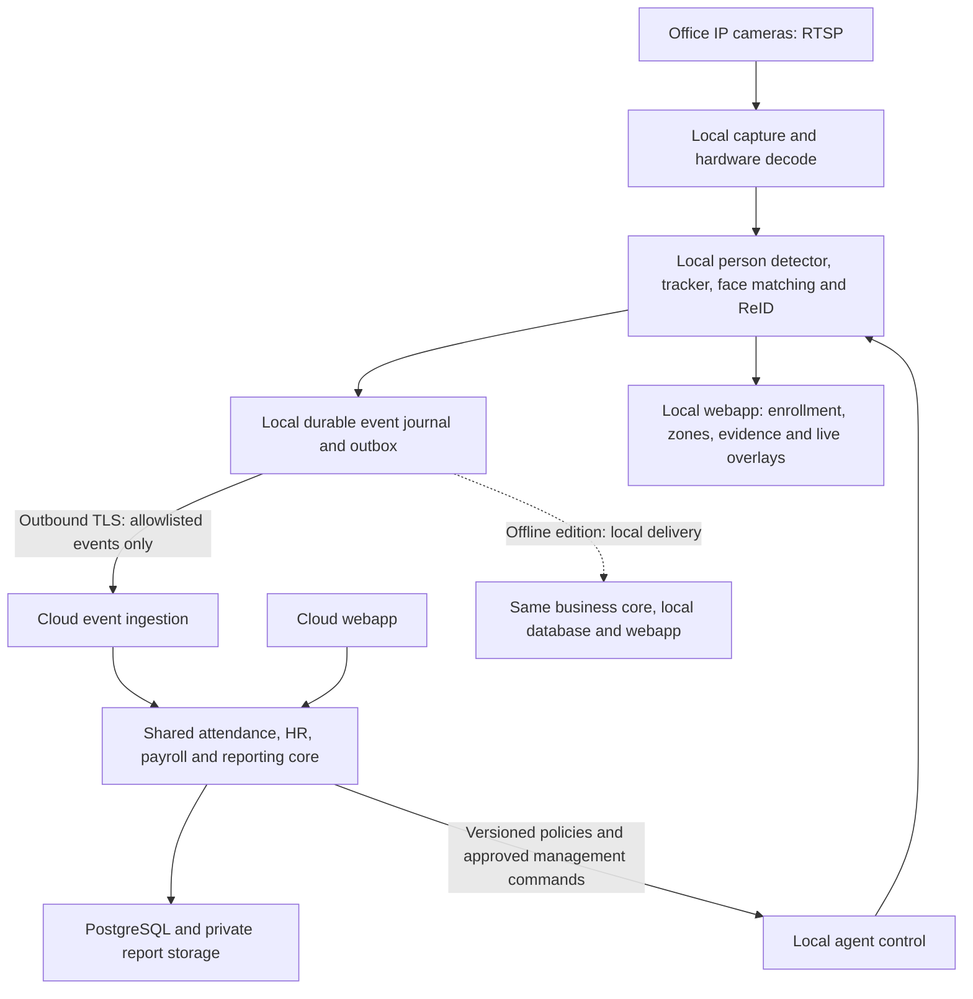

# Standalone CCTV Attendance, Presence and Payroll System

**Design v1.1 · 15 October 2026 · Initial site: 15 employees, 2 entrance/exit cameras, 10 internal cameras. Lightweight deployment is the default design priority.**

This is a compact engineering specification, not a development sequence. Proposed defaults are configurable. Hardware capacity, recognition accuracy and service targets below require measurement; they are not existing product capabilities or guarantees.

## 1. Product boundary

Independent product: no Home Assistant or Frigate runtime dependency. One codebase supports cloud-managed sites and fully offline installations. All administration uses a responsive webapp. Camera-only identity, including mouth-covered employees, is required; no RFID/QR/PIN attendance fallback. Missing attendance requires HR review. Payroll is built in. No external HR/payroll integration, remote live viewing or notification module is required.

**Identity rule:** never convert an ambiguous observation into a confident employee match. Camera-only identification has an unresolved state. Zero attendance errors cannot be guaranteed; masked performance must pass site testing. Presence indicates location, not productivity.

## 2. Architecture and data placement

| Data/function | Cloud-managed edition | Fully local edition |
| --- | --- | --- |
| RTSP credentials, frames, face images, embeddings, appearance profiles | Local only | Local only |
| Live video/name overlays and recognition evidence review | Authorized LAN users only | Authorized LAN users only |
| Raw observation journal and pending uploads | Local | Local |
| Confirmed/uncertain attendance events, interval summaries, health events | Uploaded through an explicit schema | Local |
| Employee names, salaries, rosters, leave and payroll policies | Entered through cloud webapp; necessary configuration downloaded to agent | Entered/stored locally |
| Official attendance, approvals, payroll and exports | Cloud business core | Local business core |

The events-only rule applies to **site uploads**. Cloud business records are supplied by authorized webapp users; images and biometric data never pass through that webapp's cloud backend. No cloud video endpoint, snapshot relay, biometric sync or arbitrary remote shell exists.

Cloud mode has one authoritative cloud writer for policies and payroll. A disconnected agent uses the last activated policy and queues events; it does not create a competing official payroll. Offline edition has one local authority. Changing deployment mode is an explicit export/import and ownership handover, not automatic bidirectional database sync.

## 3. Software and service specification

| Layer | Proposed specification |
| --- | --- |
| Host | Linux LTS on x86-64; packaged containers; ARM only after separate validation |
| Webapp | React + TypeScript, responsive desktop/tablet interface; English initially, translation-ready |
| API/business core | Python 3.12+, FastAPI, Pydantic; modular monolith with separate workers |
| Video | FFmpeg for RTSP/decode; OpenCV/NumPy for regions, alignment and image operations |
| Inference | ONNX Runtime; CPU baseline, optional OpenVINO/CUDA provider selected by validated hardware |
| Tracking | ByteTrack-style tracking; separate cross-camera association service |
| Business database | PostgreSQL, SQLAlchemy, Alembic migrations; same schema in cloud/local editions |
| Site event spool | SQLite WAL plus durable transactional outbox; not a second payroll database |
| Jobs | PostgreSQL-backed job/outbox workers initially; no mandatory Redis/Kafka/Kubernetes |
| Live LAN delivery | Local WebRTC player where supported, local HLS fallback; timestamped overlay metadata; no public STUN/TURN or cloud video relay |
| API updates | REST for commands/reports; authenticated WebSocket for permitted state/progress updates |
| Reports | Server-generated CSV, XLSX and PDF; private storage with short-lived authorized download |
| Packaging | Docker Compose initially; versioned images/models; horizontal cloud workers as demand grows |

Pin exact compatible dependency/image versions during implementation. API workers do not perform video inference or load a model copy per HTTP worker. Video, inference and business workers have independent resource limits.

ONNX Runtime supports provider-based acceleration; actual compatibility must be tested for each model/host. [Official provider documentation](https://onnxruntime.ai/docs/execution-providers/). Separate API/container workers follow normal [FastAPI deployment concepts](https://fastapi.tiangolo.com/deployment/docker/).

## 4. Cameras, installation and compute

| Item | Initial design target |
| --- | --- |
| Entrance and exit | Separate dedicated views; RTSP, 1080p or higher source, 15–20 FPS source stream |
| Internal cameras | RTSP, 1080p source; lower-resolution detection substream when useful |
| Codec | H.264 preferred for initial compatibility; H.265 only after decoder/browser-path validation |
| Identification view | About 6–10 feet distance; control glare/backlight; clearly visible upper face; quality gate based on actual pixels/blur/pose, not distance alone |
| Crossing geometry | Two regions plus directional line; include approach and departure, avoid simply counting someone standing near a door |
| Inside geometry | Floor-plan camera graph, overlaps, doorway transitions, travel-time windows, workstation polygons |
| Network/power | Wired gigabit LAN, PoE switch as needed, synchronized camera/host clocks, UPS for cameras/switch/agent |
| Low-cost benchmark candidate | Compact PC or reused desktop, modern 4–6-core CPU with supported hardware-decoding iGPU, 16 GB RAM, 256–512 GB SSD, gigabit NIC; not yet qualified for all 12 cameras |
| Optional accelerator | Add a validated GPU only if measured inference demand requires it; no fixed GPU commitment |
| Initial cloud envelope | Approximately 4 vCPU, 8 GB RAM, 100 GB SSD plus separate backups as an initial shared-service benchmark; not a separate VM per customer; resize from measurements |

These are **benchmark starting specifications**, not proof of 12-camera capacity or the cheapest supported configuration. The previous 32 GB RAM/1 TB estimate was a conservative starting envelope, not a fixed product requirement. Test the lighter 16 GB/256–512 GB profile first; qualify an 8 GB option only if peak-memory, outage/recovery and full-camera tests justify it. Reuse an existing compatible office desktop where practical; do not purchase solely on this document. Fully offline installations also run the business database, payroll and reports and need a separately measured resource envelope.

Lightweight sampling proposal: entry/exit 8–10 FPS; internal person detection 1–3 FPS, initially 2 FPS, with temporary bursts at transitions or uncertainty. For 2 portals at 8 FPS and 10 interior cameras at 2 FPS, the starting load is 36 sampled camera frames/second before scheduling; this is a workload estimate, not measured throughput. Detector input resolution, batching and hardware determine actual capacity. Recognition/ReID run only on selected useful crops. Prioritize portal cameras under load; record sampling/coverage degradation rather than silently claiming complete observation. Lower interior sampling can miss brief movement or harm association, so validate duration uncertainty and identity switches; do not assume the same accuracy as a faster profile.

No continuous NVR recording by default. Keep a short encrypted local evidence buffer only when enabled and sized. Continuous footage, if later requested, needs a separate storage specification: **1 Mbps continuous recording is about 10.8 GB/day per camera**, before storage overhead.

## 5. Enrollment and AI pipeline

1. HR creates employee ID, department, employment status, schedule and permitted zones. Local enrollment binds that ID to face templates through the LAN webapp.
2. Capture several quality-controlled reference views, with uncovered and mouth-covered examples where available. Proposed starting collection: 10–20 usable images; enrollment quality matters more than the count.
3. Reject blur, extreme pose, insufficient upper-face detail and multiple faces. Require operator verification of the employee binding; flag possible duplicate enrollment.
4. Store encrypted reference/template data, quality metadata and model version locally. Enrollment adds templates, not whole-model retraining.
5. Decode frames into bounded shared buffers. Person detection creates local tracks; face detection/alignment associates a face with the correct person crop.
6. Match multiple observations against the site employee gallery. Require calibrated similarity, adequate quality and separation from the next-best candidate. Do not present similarity as a probability.
7. Confirm an identity only after consistent evidence; contradictory or competing matches become `ambiguous`. Track motion between useful recognition checks.
8. Maintain short-lived appearance prototypes for the confirmed employee's active visit. Cross-camera association uses appearance, topology, travel time and one-to-one assignment; impossible simultaneous locations block a handoff.
9. Refresh with a face match when possible; invalidate on contradictions or major appearance changes. Expire appearance profiles at session end/timeout, not simply at midnight during overnight shifts.
10. Emit movement/zone events locally. Unknown visitors remain anonymous tracks; no face profile is automatically enrolled.

Proposed model interfaces: lightweight person detector, ByteTrack-style tracker, commercially permitted face detector/embedding model with masked-face evaluation, and compact appearance/ReID model. Each package declares input preprocessing, output shape, checksums, license, hardware support and threshold calibration. No arbitrary pretrained pack is approved by this design.

**Commercial model selection remains a dependency.** InsightFace's code license and supplied pretrained-model terms differ; the supplied packs require separate commercial authorization. Do not silently bundle them. [Publisher model terms](https://github.com/deepinsight/insightface/blob/master/python-package/docs/model_zoo.md). Masked recognition and cross-camera identity remain measured capabilities, not guarantees. [NIST mask evaluations](https://pages.nist.gov/frvt/html/frvt_facemask.html), [ByteTrack research/code](https://github.com/FoundationVision/ByteTrack).

Photo/replay spoofing, tailgating, similar clothing and crowded crossings belong in acceptance tests. Passive liveness is an optional local model adapter, not a claim that ordinary CCTV guarantees anti-spoof protection. No emotion, demographic or productivity inference is required.

## 6. Identity and attendance state machines

| State machine | States and principal rules |
| --- | --- |
| Identity | `unknown → candidate → confirmed`; conflicting evidence → `ambiguous`; disappearance → `lost`; reacquire only with sufficient evidence |
| Office presence | `not_observed / inside / outside / unknown`; only validated portal transitions change office entry/exit, not an internal camera losing someone |
| Attendance record | `open / provisional / needs_review / approved / locked`; underlying facts include present, approved absence, leave, holiday and off-day |
| Review | `pending → approved / rejected`; correction is an attributed event with reason and before/after values |

A confirmed direction crossing plus identity creates IN/OUT. Multi-frame confirmation and a configurable portal debounce suppress repeats, but real rapid exit/re-entry must remain possible. Do not deduplicate solely by employee/time bucket.

First confirmed IN opens the assigned shift instance; intermediate OUT/IN pairs form away intervals; the last valid OUT is provisional until shift closure. The final exit is the end boundary, not an away interval extending into the next day. Repeated OUT, unmatched IN, impossible ordering, missing OUT and uncertain identity create exceptions.

Shifts have site timezone, effective dates, scheduled start/end, early/late windows, grace, overnight boundary, breaks, off-days and holiday rules. A logical shift instance owns the business date; midnight does not split it. Multiple shifts/sites and transfers require explicit assignments and non-overlap checks.

At cutoff, unresolved shifts become `needs_review`; no fabricated OUT or automatic absence. HR can approve leave/duty/absence or correct events. Approved records can be reopened only with authorization; locked payroll is corrected through a revision/adjustment, not overwritten.

## 7. Workspace intervals and calculations

- Zone types: assigned workstation, shared workstation, meeting, dining, general office, excluded/private area, entrance/exit. Assignments are many-to-many and effective-dated.
- Polygons use normalized camera coordinates and a version. Floor zones normally use feet/bottom-center; seated workstation views may require a calibrated torso/seat rule because feet can be hidden.
- Membership uses configurable dwell/hysteresis to suppress jitter. Proposed start: 2 seconds to confirm a transition; event time refers to the first qualifying observation, not confirmation delay.
- Multiple cameras observing the same person/zone contribute a **union** of intervals, never summed overlapping durations. Per-employee states are mutually reconciled.
- At loss of trustworthy observation, close confirmed duration at the last supported observation and mark a gap unknown. A reassociation timeout is not permission to count the entire gap as presence.
- Office presence, zone presence, approved duty, exemptions and uncertainty are independent dimensions. An internal camera miss does not imply office exit.

Calculations use UTC instants and half-open intervals `[start, end)`; display/report using site timezone, initially Asia/Dhaka. Duration uses interval union/intersection, not frame counts.

`eligible time = confirmed office intervals ∩ configured measurement windows − exempt breaks/duty intervals`

`workspace time = union of confirmed eligible assigned-workspace intervals`

`workspace presence % = workspace time / eligible time × 100`

Show observed eligible time, unknown time, policy exclusions and coverage alongside the percentage. Zero eligible duration returns N/A. Incomplete office boundaries produce provisional results. Configured policy can also include approved meeting/duty zones in a separate eligible-activity metric. No workspace percentage feeds payroll by default.

## 8. HR and payroll

| Area | Required behavior |
| --- | --- |
| HR records | Employment dates/status, departments/designations, site, contract/pay basis, effective salary history |
| Attendance policy | Rosters, holidays, paid/unpaid leave, approved duty, grace, late/early, breaks, overtime eligibility and approval |
| Salary structure | Base pay, fixed/variable allowances, bonuses, reimbursements where applicable; configurable taxable/non-taxable classification |
| Adjustments | Approved unpaid absence, advances/installments, deductions and other company-defined components; reason and authorization |
| Calculation | Fixed/monthly/hourly basis, configured divisor, proration, approved overtime rate/multiplier, rounding and component order |
| Controls | Draft → calculated → reviewed → approved → locked; unresolved pay-affecting records or incomplete site sync block finalization |
| Outputs | Itemized payslip, payroll register, attendance reconciliation, component totals, adjustment history; no bank payment execution |

`net pay = configured earnings + approved additions − approved deductions`

Use BDT initially and Decimal/fixed-point monetary arithmetic; store final amounts with two decimal places and rates/intermediates at greater precision. Do not use floating-point salary arithmetic. Record input attendance revision, salary/policy versions, calculation details and approver for each line.

Policies are validated expressions over an allowlisted calculation model, not arbitrary Python/SQL. No Bangladesh statutory rate is invented here: applicable company/legal policies must be configured and validated before live payroll. A corrected approved period creates an adjustment or new version, preserving the original payslip. Software calculates payroll; human approval authorizes finalization.

## 9. Data model and integrity

| Group | Principal entities |
| --- | --- |
| Organization | Tenant/company, site, department, employee, employment, user, role, site membership |
| Capture/local identity | Agent, camera, portal, camera graph, model package, enrollment, face template, local evidence, track/identity session |
| Policies | Shift template/instance, roster, holiday calendar, leave type/request/approval, break policy, attendance rule version |
| Presence | Immutable source event, crossing, office interval, away interval, zone, zone assignment/version, workspace interval, coverage gap |
| Business results | Attendance day/revision, exception/review, correction, salary structure/version, payroll period/run/item, payslip |
| Operations | Outbox, ingestion receipt, agent command/ack, sync watermark, job, audit entry, retention task, backup record |

Every business row carries tenant/site scope where applicable. Use tenant-aware composite foreign keys, unique employee codes within company, unique source event IDs, and `(employee, shift instance)` uniqueness. Index tenant/site/time and employee/time; partition high-volume events as volume warrants.

Source events are append-only within retention; corrections append superseding events. Derived attendance/intervals can be deterministically rebuilt. Retention deletion is controlled/audited and does not silently remove facts still required by an active review or payroll run.

Core event envelope: `schema_version, event_id, tenant_id, site_id, agent_id, camera_id, camera_sequence, capture_time_utc, received_time_utc, type, employee_id|null, identity_status, zone_id|null, model_version, policy_version, quality_flags, supersedes_id|null`. No vectors, image bytes, snapshots, RTSP credentials or unrestricted free-text logs may enter the upload schema.

## 10. Offline behavior and synchronization

Persist event + outbox atomically before upload. Cloud commits an event and durable receipt before acknowledgment. Delivery is at least once; unique IDs make business effects idempotent. Include per-camera sequences/session IDs and gap/coverage events; avoid a global sequence bottleneck.

Events retain capture time, clock quality and ingestion time. Reject/quarantine impossible clocks; reorder late events within policy and rebuild affected unlocked results. An acknowledgment alone does not prove complete time coverage: watermarks and explicit gaps determine closure readiness.

Cloud displays last sync and provisional status. When agent/cloud disconnects, local recognition and durable capture continue. Budget spool capacity for a configured outage window, initially seven days; use disk alerts/backpressure and preserve attendance events ahead of optional diagnostic data. Never silently discard unacknowledged events. Local UI shows unknown/provisional when the agent loses trust or coverage.

Business commands carry ID, target, version, expiry and expected prior version. Local agent validates and acknowledges activation; new policies apply at defined boundaries. Camera secrets and enrollment updates stay local. Fully offline installations require no external login, mandatory license heartbeat or model download at runtime.

## 11. Webapp screens and permissions

| Screen | Compact feature specification |
| --- | --- |
| Dashboard | Present/away/unknown/leave/review counts, day summary, agent freshness; cloud has event-only status |
| Employees | Profile, employment, schedule, salary history; local-only enrollment and template status |
| Cameras and layout | Local credential entry/test, roles, quality/health, floor plan and camera-transition graph |
| Zones | Local frame polygon editor, zone type, employee/shared assignments, effective dates |
| Live monitor | LAN-only grid/single view, names/unknown, zones, timestamp-aligned overlays, permissions |
| Attendance | Day timeline, IN/OUT, away, late/early/overtime, status, coverage and correction history |
| Review inbox | Missing/ambiguous/duplicate/outage cases, leave lookup, decisions; visual evidence accessible only on LAN |
| HR and policy | Shifts/rosters/calendars, leave, duty, breaks, company rules and policy simulation |
| Payroll | Components, draft run, exception blockers, itemized calculations, review/approval, locked payslips |
| Reports | Daily/monthly attendance, leave, overtime, workspace/coverage, payroll, audit; filters and exports |
| Operations | Camera/agent/AI status, last event, queue lag, disk, versions, updates, sanitized logs, backup status |
| Administration | Users, site-scoped roles, retention, deployment mode, audit and recovery |

Roles: platform operator, company administrator, HR reviewer, payroll operator/approver, local security operator, read-only auditor. Separate salary, biometric, video, correction and payroll-approval permissions. Platform support has no biometric/video access and no automatic payroll access. Employee self-service is not a required module. No notification feature beyond in-app operational/review indicators.

Cloud HR can approve metadata/leave cases. If a case needs visual evidence, an authorized person must review locally and submit an audited resolution event; evidence is not proxied to the cloud. Local login remains available when internet is down, with locally enforced permissions and an offline recovery process. The offline package includes web assets, fonts, reports and models; LAN HTTPS uses an explicitly provisioned trusted certificate without mandatory public-internet access.

## 12. APIs and jobs

Versioned `/api/v1` groups: `auth`, `companies/sites`, `employees`, `shifts/rosters`, `leave`, `attendance/events/days/reviews`, `zones`, `payroll/structures/runs/payslips`, `reports/jobs`, `agents/health/commands` and `audit`.

Separate machine API: `/agent/v1/events:batch`, `receipts`, `policy`, `commands`, `heartbeat`. Server derives tenant/site from the agent credential; payload IDs cannot expand authority.

LAN-only API: camera credentials, preview/live tokens, enrollment/templates, zone frame editing and evidence. Public/cloud routes cannot reach these handlers. WebSocket topics and exports enforce the same tenant/site and field permissions as REST. Jobs use stable IDs, retries, cancellation, limits and durable progress.

## 13. Security and retention

TLS; per-agent certificates with rotation/revocation; secure HttpOnly cookie sessions for users; Argon2id password hashes; login throttling; CSRF/origin checks; short-lived LAN video tokens; no camera port exposure. Local device identity is distinct from employee biometric identity.

Encrypt disks and sensitive local stores, keep secrets outside images/config exports, separate biometric keys from the database and protect recovery keys. Isolate the camera network; restrict agent egress to allowed schemas/destinations and disable imagery/embedding attachments in telemetry. Validate RTSP destinations, uploaded images, export fields and report downloads.

Tenant isolation uses application authorization plus PostgreSQL RLS, a non-owner application role without bypass privileges, and explicit tenant context for jobs/exports/subscriptions. Test pooled-connection context reset and cross-tenant denial. [PostgreSQL RLS behavior](https://www.postgresql.org/docs/current/ddl-rowsecurity.html).

| Category | Proposed retention policy |
| --- | --- |
| Attendance/business events and summaries | Customer-selected 90 or 365 days, subject to unresolved cases/record dependencies |
| Payroll and audit | Separate policy; do not assume the attendance window is appropriate; configure before production |
| Face profiles | Active employment plus explicitly configured offboarding grace; revoke immediately on deactivation |
| Appearance prototypes | Active visit/shift only, bounded expiry |
| Local evidence | Disabled unless authorized; short policy such as 7 days, extended only for reviewed cases |
| Continuous video | Off by default |
| Diagnostic logs | Proposed 14–30 days, sanitized and capped |

Deletion applies to replicas, reports and eventual backup expiry; restore must reapply deletion/revocation markers. User notice, company authorization and customer data-handling policies are deployment requirements; this document does not certify Bangladesh legal compliance.

## 14. Reliability, operations and cost controls

Per-camera capture supervision with retry/backoff, compact native decoder processes as needed, and shared Python worker pools rather than a complete Python/model stack per camera; bounded frame queues; portal priority; watchdogs; disk/clock health; durable source events; deterministic replay. Live overlays carry camera/track IDs, frame timestamp and confidence state; hide stale names instead of drawing them over a different person.

Initial service objectives: LAN overlay delay under 2 seconds, cloud event visibility under 10 seconds on a healthy connection, operator camera-failure indication within 30 seconds. Measure p95 latency and resource use; outage states suspend those objectives rather than falsifying timeliness.

Use metrics for sampled/dropped FPS, decode/inference latency, camera uptime, template quality, ambiguous matches, identity switches, portal misses, event lag, outbox size, disk and payroll blockers. Remote diagnostics upload sanitized technical fields only; no frame dumps, credentials, templates or employee names in generic logs.

Encrypted off-host business backups; encrypted on-premise biometric backups; scheduled restore exercises. Proposed business RPO ≤24 hours/RTO ≤4 hours; event-spool backups/redundancy need separate sizing. A single agent/SSD cannot promise zero loss during hardware destruction. UPS, mirrored storage or a second journal node are options if the recovery requirement demands them.

Signed versioned updates, preflight/migration backup, health checks and reversible rollout. Database downgrades require compatible migrations or restore; an image rollback alone is insufficient. Offline updates arrive as verified packages, with models/licenses included.

Keep costs down with local decode/inference, selected crops processed only locally, event/interval uploads instead of frames, shared model instances, no full-video retention, and a modular business service. Measure total cost as site equipment + power/UPS + model licenses + cloud/database/backups + maintenance. No monthly price or cheapest hardware guarantee is set here.

## 15. Acceptance gates

| Area | Required evidence before operational acceptance |
| --- | --- |
| Identity | Site-labeled tests with masked/unmasked faces, similar clothing, light/pose/crowding, visitors and spoof attempts; separate false-match and missed-match measurements |
| Cross-camera | Identity switches, handoff precision, unknown coverage and recoveries measured across actual rooms; appearance-only guesses never silently become confirmed attendance |
| Portals | Manually labeled IN/OUT audit, repeats, tailgating, rapid re-entry and missing-face cases; no unresolved case silently approved |
| Attendance | Exact expected results for overnight shifts, breaks, leave, holidays, missing events, clock errors, corrections and late-arriving events |
| Payroll | Golden company-approved salary examples match every component/rounding; unresolved records block approval; locked-run revision tests |
| Synchronization | Retry/reorder/restart/outage tests yield one business effect per source event; gaps remain visible |
| Privacy/security | Network capture confirms no imagery/embeddings leave site; remote video denied; cross-tenant/video/salary permission tests pass |
| Capacity/recovery | All 12 cameras run with measured headroom; crash/reboot/disk-full handling, backlog drain, backup restore and update recovery verified |

Proposed evaluation run: representative office operation covering at least ten working days and all important exception scenarios. Report empirical errors and sample counts; even zero observed errors does not prove a universal zero-error rate. Final numeric accuracy and review-volume thresholds require user acceptance after these measurements.

## 16. Remaining inputs, without blocking the design

Camera models/streams and office layout; available site computer; enrollment authorization/evidence policy; representative salary/leave/overtime examples; payroll/audit retention and approval roles; acceptance thresholds. The system's ownership, cloud/local separation, modules, data flow and extension points above are defined; these inputs finalize installation sizing and business-policy values.

## 17. Lightweight edge specification and cost controls

| Resource/cost | Default design control |
| --- | --- |
| Local services in cloud mode | Capture supervisor, shared inference/tracking workers, SQLite event journal, sync and small LAN API/UI only; no local PostgreSQL, payroll/report workers, Redis or Kubernetes |
| Model memory | One loaded session per model/device where supported; share among camera jobs; cap batch size and concurrent executions to measured limits |
| Video decode | Hardware decode when actually supported by camera codec/host; avoid additional full-resolution copies, resizes and color conversions; verify acceleration rather than assuming it from an iGPU label |
| Interior input | Use camera-provided substreams at a measured adequate resolution; preserve detailed portal face input; a low-resolution crop cannot recover lost face information by upscaling |
| Detector scheduling | Reserved portal budget, fair interior scheduling, periodic presence refresh and bounded uncertainty-triggered bursts; avoid unbounded work during crowding |
| Recognition | Face quality gate, a small batch of useful observations and periodic rechecks; no recognition on every frame and no complete-model retraining per employee |
| Cross-camera ReID | Trigger mainly at track creation, doorway handoff, lost-track recovery or contradictory evidence; search plausible site/session candidates before broader candidates |
| Idle cameras | Low-rate periodic refresh plus movement/activity triggers; do not stop observation merely because a seated employee is stationary |
| Frame queues | Latest-frame buffers of one or two frames per camera; discard stale inference work and expose resulting gaps; preserve durable attendance events independently |
| Live viewing | Browser draws timestamp-aligned names/boxes; prefer compatible compressed-stream passthrough over server-side annotated-video encoding; proposed default of four simultaneous visible players |
| Storage | No continuous recording; encrypted, quota-limited optional evidence; session-limited appearance data; capped logs/model cache; size SSD from actual retention/outage needs |
| Cloud traffic/storage | Upload crossings, zone transitions, coalesced presence/coverage intervals and bounded health events, not per-frame boxes/features; report generation occurs in cloud |
| Shared cloud deployment | Tenant-isolated shared API/database/worker capacity; additional workers when measured load requires them; no per-company infrastructure stack by default |
| Process supervision | Limit worker count and threads; no per-frame process spawn; restart individual failed capture tasks, not every camera/model |
| Full offline edition | Reuses business core but includes its local database/auth/payroll/report overhead; do not advertise cloud-agent sizing as the full-offline minimum |

Configure sampling, input size, job concurrency, live-player count, evidence quota and logging through validated resource profiles. All profiles retain core functionality and explicit unknown states; they do not relax identity-confirmation thresholds simply to appear faster. Portal reliability takes priority over interior smoothness. Resource changes are versioned and audited.

Proposed qualification target for the cloud-managed agent: explore a 4–6 GB application working-set budget, excluding host OS and filesystem cache, on the 16 GB candidate. This is an optimization target, not a demonstrated memory requirement. Reserve sustained CPU/memory headroom and test simultaneous arrivals, crowding, viewing, reconnection and backlog drain. Set hard limits only after measuring peaks so an arbitrary container memory limit does not create dropped attendance.

Measure per-stage decode/preprocess/detection/face/ReID latency, p95 queue age, memory/CPU/iGPU use, uncertainty coverage, recognition errors and portal completeness on all 12 cameras. If the inexpensive profile fails, first optimize unnecessary work, stream configuration and camera placement; then evaluate hardware uplift. Do not silently downgrade accuracy, omit cameras, move biometric inference to cloud or promise arbitrary camera counts on a cheap mini PC.
